<p align="center">
  
</p>

<h1 align="center">تخرُّج · Takharruj</h1>

<p align="center">
  <strong>A platform that runs graduation projects from the first idea to the final grade.</strong><br>
  Students, supervisors and the department, one place, three dashboards, one trail of record.
</p>

<p align="center">
  <a href="https://takharruj.vercel.app"><strong>▶ Open the live demo</strong></a>
  ·
  <a href="README.ar.md">العربية</a>
  ·
  <a href="docs/DEPLOYMENT.md">Install &amp; deploy</a>
  ·
  <a href="DESIGN_SYSTEM.md">Design system</a>
</p>

<p align="center">
  
  
  
  
  
  
  
</p>

---

## Try it in thirty seconds

The demo needs **no account**. Open it and pick a role, you are signed straight in,
and a bar at the top lets you switch between the three without signing out, so you can
send a message as the student and read it as the supervisor.

| | What you land in |
|---|---|
| **Try as a student** | A real project at 80%, its five milestones, the thread with the supervisor, and a defense already scheduled |
| **Try as a supervisor** | Supervised groups, incoming requests, milestone review, and the committee you sit on |
| **Try as an admin** | The semester, 500 students and 300 supervisors, the defense planner, and the audit log |

> The data is curated and resets every night, so nothing you do there can break it.

**▶ [takharruj.vercel.app](https://takharruj.vercel.app)**

---

## The problem it solves

Graduation projects are run on spreadsheets, WhatsApp groups and email threads. Nobody
can answer *which groups still have no supervisor*, *which milestones are overdue*,
*where is the latest version of that chapter*, or *who changed this grade and when*.

Takharruj puts all of it in one place and gives each role only the part that concerns them.

---

## What each role sees

### Student

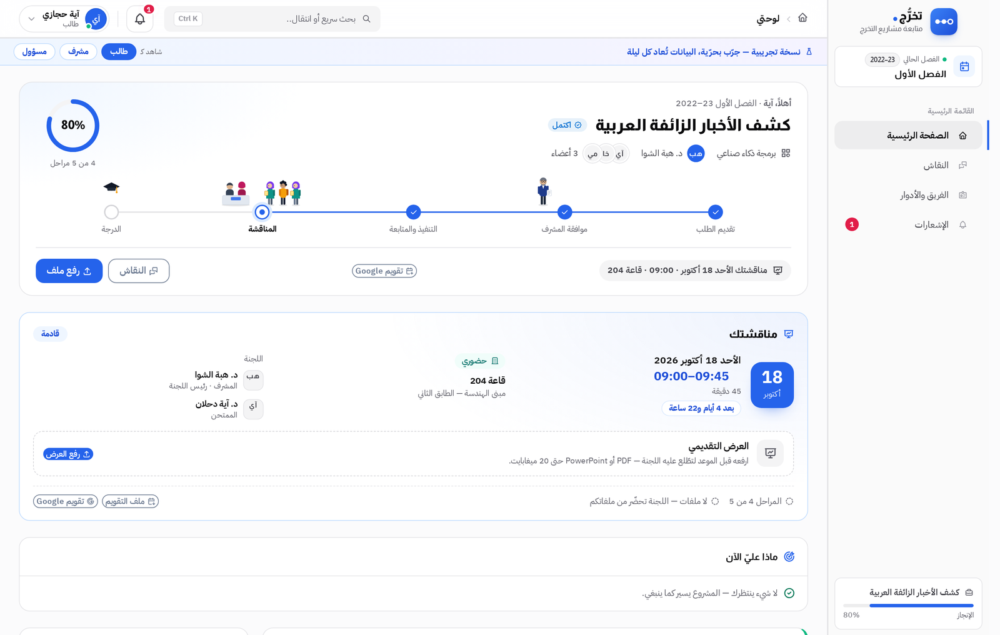

Your project, your progress, and what is expected of you next. The timeline runs from
*request submitted* through *supervisor approval* and *milestones* to *defense* and
*grade*. The defense card carries the date, the room, the committee and a calendar file,
and the presentation is uploaded from the same card.

### Supervisor

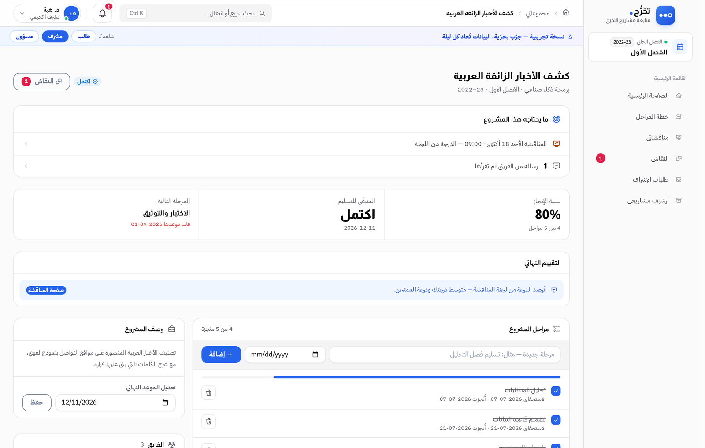

One screen per supervised project: what it needs now, completion, the milestone plan
with its deadlines, the files submitted against each one, and the thread with the team.
Requests are accepted or rejected from the dashboard; past semesters stay in the archive.

### Admin

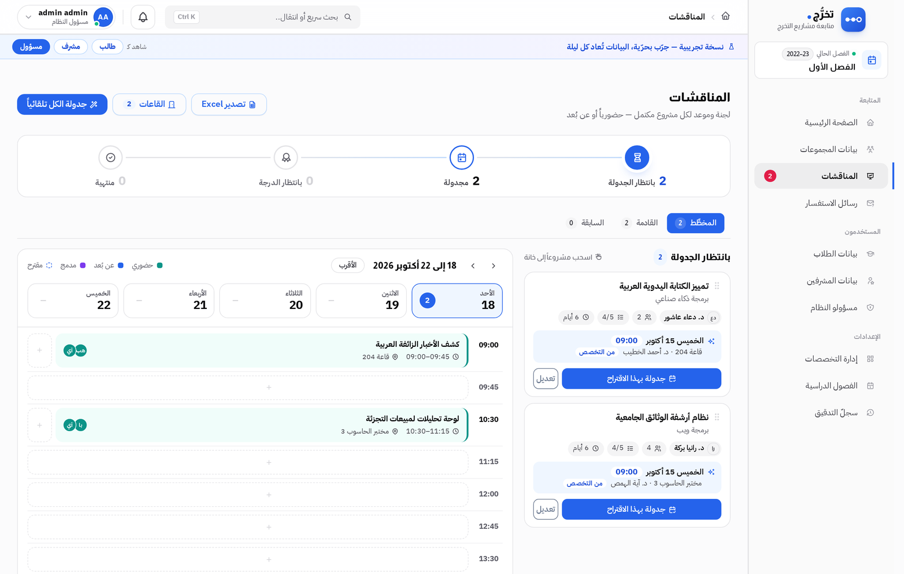

The semester, its people and its defenses. The planner proposes a slot, a room and an
examiner for every completed project; drag a project onto a slot, or schedule the whole
list in one click. Every change lands in an append-only audit log.

<details>
<summary><strong>More screens</strong></summary>

| | |
|---|---|
| Public site | 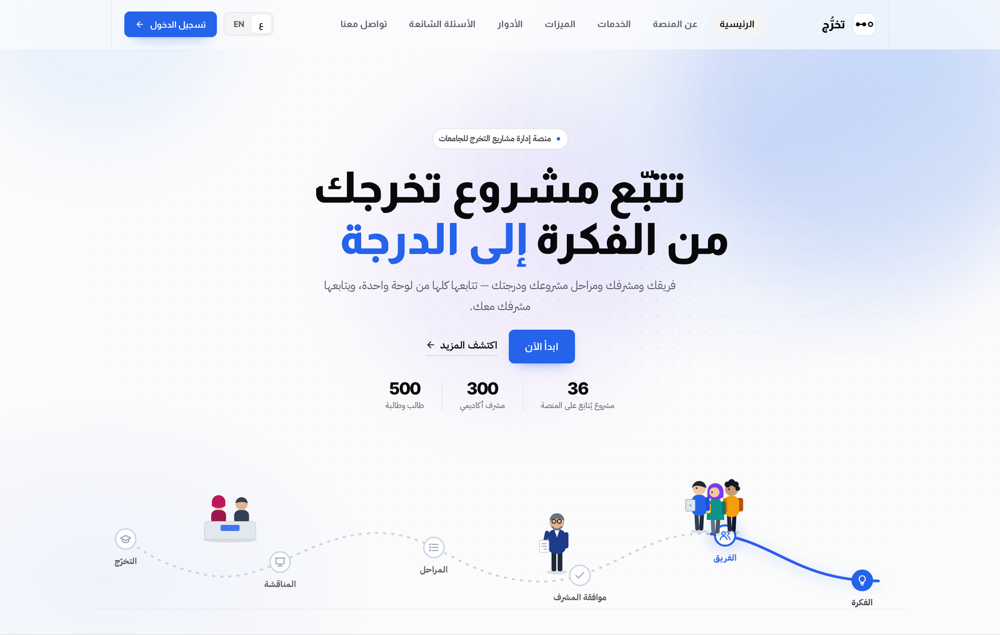 |
| One-click demo sign-in | 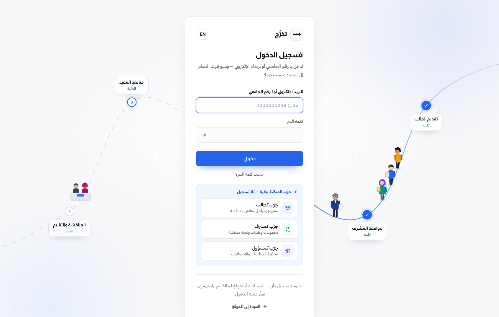 |
| Student: discussion with the supervisor | 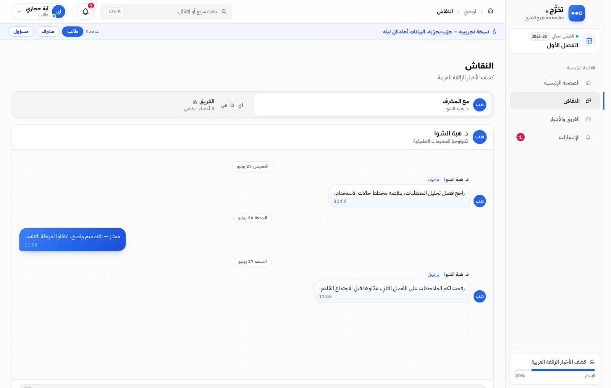 |
| Student: team and roles | 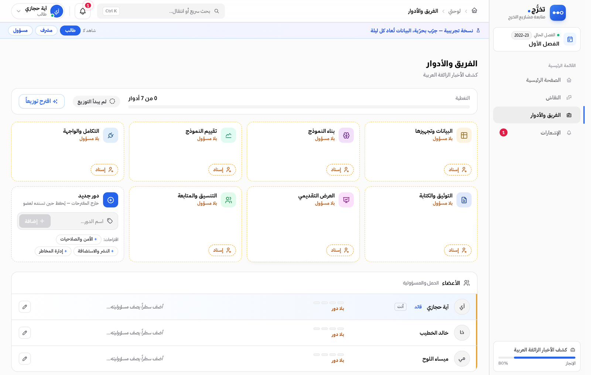 |
| Student: archive of completed projects | 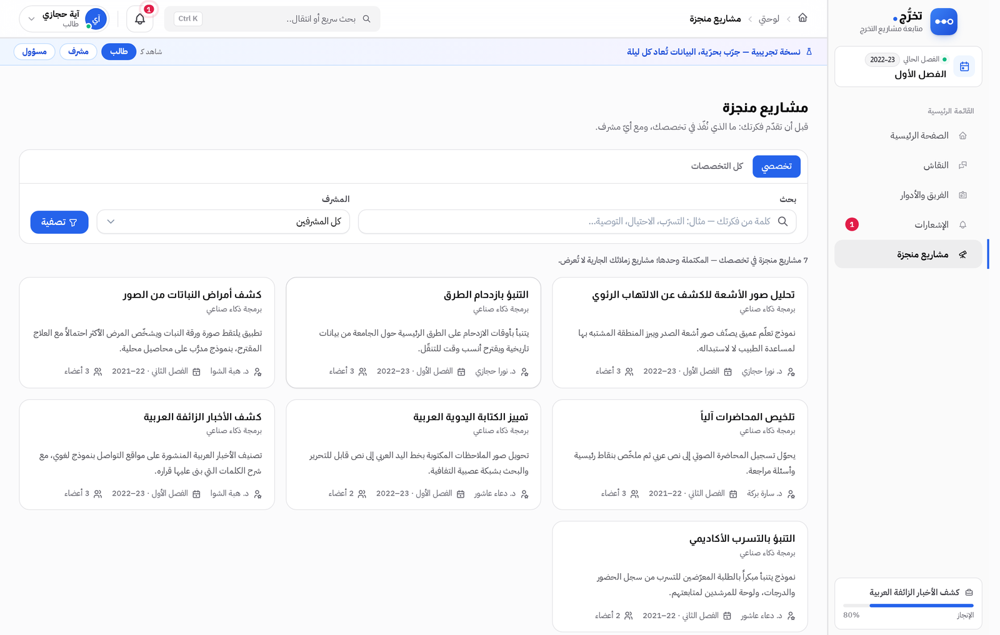 |
| Supervisor: dashboard | 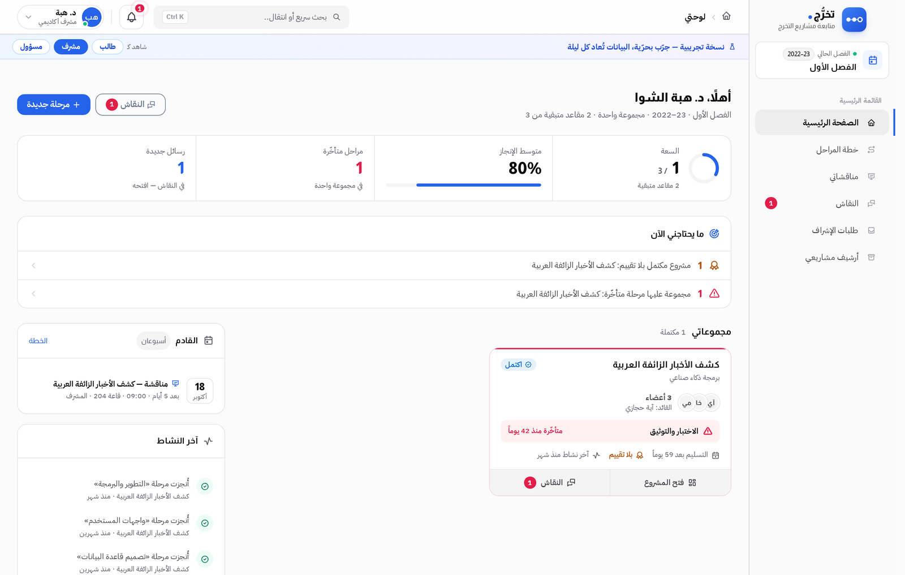 |
| Supervisor: milestone plan | 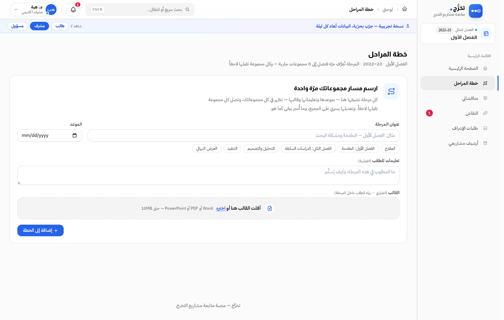 |
| Supervisor: my committees | 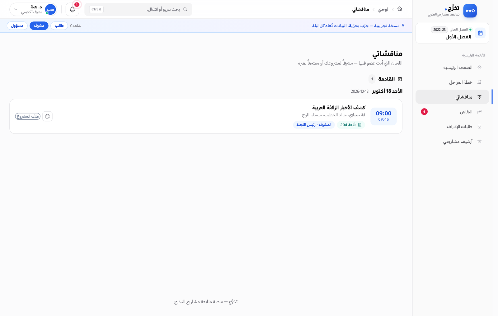 |
| Admin: dashboard | 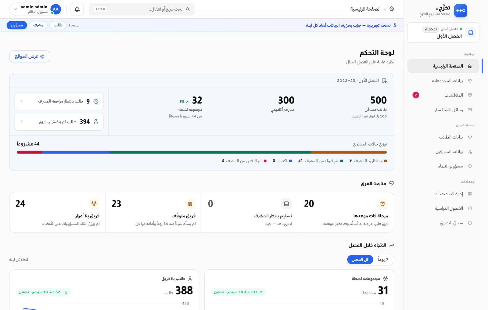 |
| Admin: groups | 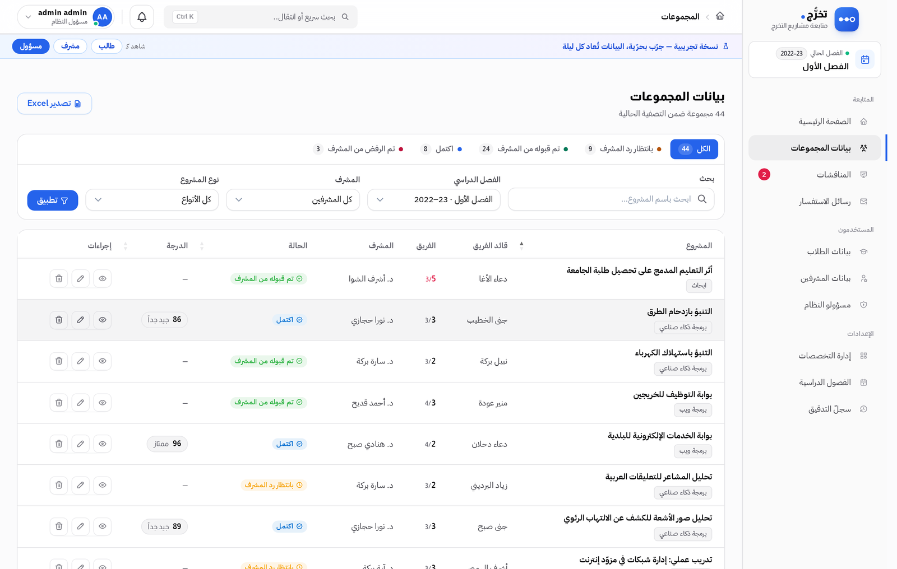 |
| Admin: audit log | 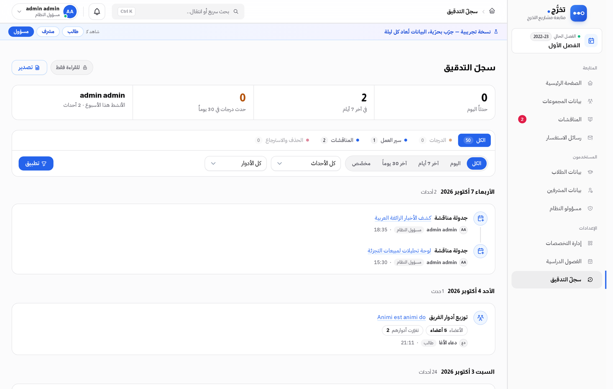 |

On a phone, every dashboard is the same product, not a cut-down one:

<p>
  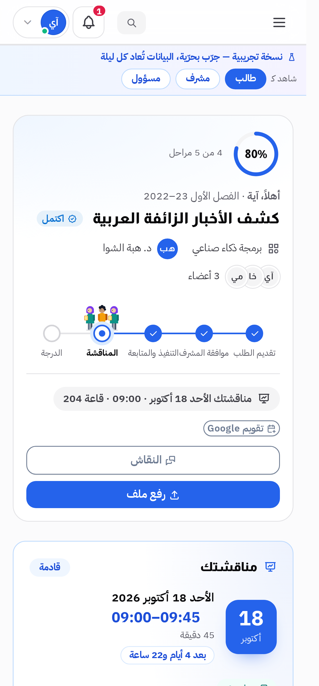
  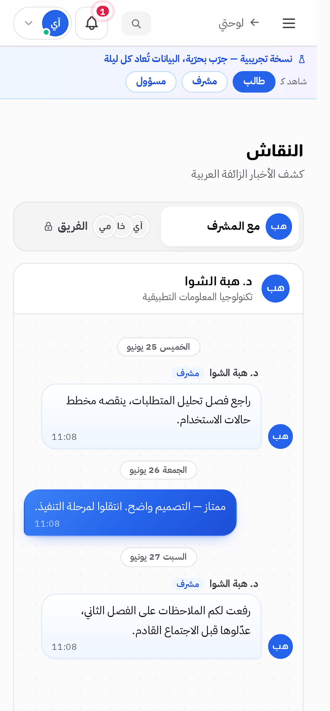
</p>

</details>

---

## What it does

**Running a semester.** Students, supervisors, specialisations and terms, with bulk
import from Excel, which matters when a new intake is 300 rows, and export back out.
One term is active; the rest become the archive.

**Forming teams.** Groups, roles inside a group, and supervisor assignment. A student
proposes a project or picks from the department's catalogue of topics; the supervisor
accepts, rejects or asks for changes.

**Milestones.** A plan per project with deadlines, submissions against each milestone,
and reminders by email two days before and on the day. The rest of the noise stays in
the app, where it belongs.

**Files and discussion.** Project files are stored privately and served only through an
authorised download route, never from a public folder. Threads run between the team and
the supervisor, and separately inside the team, with unread counts and live updates.

**Defenses.** Rooms, committees and a scheduler. A committee is the supervisor plus up to
three examiners, one of them chair. The planner suggests a slot inside working hours,
sends the team and the committee a reminder with an `.ics` file, records the minutes, and
computes the grade as the members' average, with a configurable weight for the supervisor.
Once the grade is locked it cannot be quietly edited.

**Accountability.** An append-only audit log with its own timeline view, so every status
change, grade and deletion has a name and a timestamp against it.

**Arabic and English.** The product is Arabic-first and right-to-left, with a full English
locale, not a machine-translated afterthought.

---

## Under the hood

| | |
|---|---|
| Models | 22 |
| Controllers | 37 |
| Migrations | 41 |
| Blade views | 115, over 16 shared components |
| Automated tests | **481**, across 65 files |
| Artisan commands | 8, including a deployment readiness check |

The tests are not decoration: alongside the feature flows they cover SQL injection
attempts, production configuration, import validation, timezones, translation keys,
grade locking and demo-mode safety.

**Design system.** The public site, the sign-in page and all three dashboards are driven
by one documented token layer ([`DESIGN_SYSTEM.md`](DESIGN_SYSTEM.md)). Colours, radii,
shadows and motion are declared once in two stylesheets and never hard-coded in a page,
rebranding means editing two files, not forty.

---

## Built with

**Back end**: Laravel 12 · PHP 8.2 · MySQL · Laravel Sanctum
**Tables and files**: Yajra DataTables (server-side, so large lists stay fast) · Maatwebsite/Excel
**Views**: Blade, with a shared component layer (`page-header`, `kpi-card`, `status-badge`, `empty-state`, `attention-card`)
**Marketing site**: Next.js 14 · React 18 · Tailwind CSS · Framer Motion · Lenis

---

## Run it locally

```bash
composer install
cp .env.example .env && php artisan key:generate
# set DB_* in .env, then:
php artisan migrate --seed
php artisan serve                     # http://localhost:8000
```

Outside production `--seed` loads demo users (one admin, 300 supervisors, 500 students).
There is no asset build step for the Laravel app.

Running the tests, deploying to a server, the scheduler, demo mode and the Vercel setup
are all in **[docs/DEPLOYMENT.md](docs/DEPLOYMENT.md)**.

---

## Project structure

```
app/Models/                        Project · Group · Student · Supervisor · Semester
                                   Defense · DefenseMember · DefenseRoom · AuditLog
                                   ProjectMilestone · ProjectFile · ProjectComment …
app/Http/Controllers/Admin/        students, supervisors, groups, semesters,
                                   specialisations, project catalogue, defenses, audit
app/Http/Controllers/Supervisor/   dashboard, project management, plan, committees
app/Http/Controllers/Student/      dashboard, team, files, discussion, profile
app/Console/Commands/              reminders, stats snapshot, demo reset, deploy check
resources/views/components/        shared Blade UI components
resources/lang/{ar,en}/            both locales
public/assets/css/premium.css      design tokens, public site
public/css/dashboard.css           design tokens, dashboards
frontend/                          Next.js marketing site
tests/                             481 tests
```

---

## Author

**Ahmed Al-Hawajiri**: Full-Stack Developer
[GitHub](https://github.com/ahmedalhawajri89) · [LinkedIn](https://www.linkedin.com/in/ahmedalhawajri)

Licensed under the MIT License.
